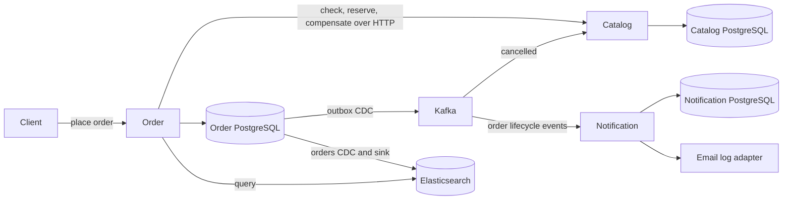

# System boundaries and data ownership

The executable example comprises three independently built Spring Boot services, two published Java libraries, and a separate live-system test project. Each service has its own application entrypoint, Gradle build, Flyway migrations, and Helm chart. The repository also distributes architecture workflow skills; those are a documentation and design toolchain, described in [Architecture evidence](../workflows/architecture-evidence.md).

## State and responsibility

| Owner | Public surface | Authoritative state | Supporting mechanisms |
|---|---|---|---|
| Catalog | `/api/v1/books`, including stock reserve/release | Books and stock counts in its PostgreSQL database | Redis detail cache; cancellation event consumer |
| Order | `/api/v1/orders`, including cancellation | Order lifecycle, item snapshots, and totals in PostgreSQL | Catalog HTTP client; outbox; Elasticsearch read model |
| Notification | Order-event consumers; `/api/v1/notifications?customerId=…` | Notification delivery records in PostgreSQL | Customer lookup stub and email log adapter |
| Seedwork | Library contracts and Spring auto-configuration | Technical tables in each consuming service database | Buses, aggregate events, outbox, deduplication, retry, HTTP errors |
| Shared events | Published Avro SDK and Kafka resource tooling | Event schemas and topic definitions | Generated Avro classes and Schema Registry registration |

The service configurations point at separate `catalog`, `order`, and `notification` databases. This expresses logical ownership; it does not require three PostgreSQL server processes. Redis and Elasticsearch hold derived data, not the authoritative inventory or order write state. See [Runtime configuration](../operations/runtime-and-deployment.md).

## Entry mechanisms and dependency direction

The domain aggregates own business state transitions and depend on shared domain primitives. Persistence interfaces describe domain-facing storage; infrastructure adapters implement those interfaces. Application handlers coordinate I/O and domain decisions.

The current services use two entry mechanisms. Order controllers dispatch commands through `CommandBus`; notification queries dispatch through `QueryBus`. Catalog controllers instead inject typed inbound use-case interfaces and invoke `handle` directly. Catalog's `ReserveStockCommandHandler`, for example, implements `ReserveStockUseCase`. Do not infer a bus dispatch merely from a class being named a handler. [Seedwork](../concepts/seedwork.md) explains the bus implementation and event handoff.

## Representative runtime flow

Placement checks stock, calculates a price, reserves each line through Catalog HTTP calls, then saves the placed order. Failures after successful reservations trigger best-effort HTTP releases. This is a multi-service sequence, not one distributed database transaction. Follow [Order lifecycle](../workflows/order-lifecycle.md) and [Catalog inventory](../workflows/catalog-inventory.md) for the precise limits.

Cancellation saves an order-domain event; the order outbox maps it to an Avro integration event. Catalog consumes cancellation to release stock; Notification consumes order lifecycle events to create delivery records. Order read-model CDC is a separate pipeline from integration-event delivery. Its detail query can fall back to PostgreSQL when Elasticsearch yields no result; list queries remain Elasticsearch-backed. See [Event delivery](../integrations/event-delivery.md), [Read model](../integrations/order-read-model.md), and [Notifications](../workflows/notifications.md).

## Evidence and change navigation

Start with the [Order command controller](../../order/src/main/java/com/example/order/interfaces/rest/OrderCommandController.java), [Catalog command controller](../../catalog/src/main/java/com/example/catalog/interfaces/rest/BookCommandController.java), and [Notification query controller](../../notification/src/main/java/com/example/notification/interfaces/rest/NotificationController.java). Then follow handlers into domain models and adapters rather than treating the README's conceptual diagrams as runtime guarantees.

The [Order component test](../../order/src/test/java/com/example/order/component/OrderComponentTest.java) demonstrates HTTP, database, and mocked Catalog boundaries. It does not run the production CDC connectors. The [verification map](../testing/verification-map.md) distinguishes those component assertions from tests against running services.
