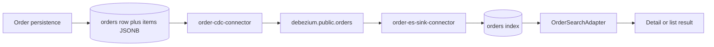

# Order CDC and Elasticsearch read model

PostgreSQL owns the order write state. Elasticsearch serves derived order detail and customer/status search projections. The read model is populated by table CDC and an external sink connector; it is separate from the Avro integration events described in [Event delivery](event-delivery.md).

## Single-row snapshot and connector flow

Migration `V0102` moves line items from `order_item` into `orders.items` JSONB, migrates existing rows, drops the old table, and sets replica identity full. `OrderJpaEntity.ItemJson` stores snake_case keys such as `book_id` and `unit_price_cents`, while preserving item ID, title, currency, and quantity.

The Orders CDC hook registers a PostgreSQL connector with slot `order_cdc_slot` and publication `dbz_orders_publication`. It snapshots existing rows initially, then streams `public.orders`. `ExtractNewRecordState` removes the Debezium envelope; configured deletion handling drops deletions and tombstones. This pipeline is configured for lifecycle updates such as cancellation, not a documented hard-delete synchronization path.

The sink hook uses Aiven's `OpensearchSinkConnector` pointed at the Elasticsearch endpoint. Its transformations extract `id` from the record key, rename selected snake_case order columns to camelCase, and route records into the `orders` index. It keeps the items JSON string intact. Both hook jobs update an existing connector by PUT or create it by POST. Endpoint and connector names are fixed in the templates, so changing only service Elasticsearch configuration does not automatically change the sink destination.

## Read behavior and consistency

`OrderElasticDocument` represents `items` as unindexed text. `OrderSearchAdapter` parses that string with `ItemDocumentListConverter`, whose item record maps snake_case fields back to Java components. Null, blank, or malformed JSON returns an empty item list; parse failures are logged.

| Read | Successful Elasticsearch result | Miss or adapter exception |
|---|---|---|
| Order detail | Returned immediately | Adapter returns empty; handler reads a PostgreSQL DTO projection and throws not-found only if that is absent too |
| Customer/status list | Returns paged search results as summaries | Adapter logs and returns an empty list; no database fallback |

An existing Elasticsearch hit wins even if it is stale. The detail handler does not compare versions or freshness with PostgreSQL. A document whose item JSON fails to parse can still be returned with an empty list, so that condition does not itself trigger fallback. Search failures and genuinely empty search results also have the same list response shape. These are practical consequences of the current code, not guarantees of read-your-writes consistency.

The PostgreSQL detail adapter builds DTOs directly from JPA entity data. It shares persistence implementation with the write port but does not reconstitute an Order aggregate for that projection. Follow [Order lifecycle](../workflows/order-lifecycle.md) for the write transaction.

## What the tests establish

- [GetOrderQueryHandlerTest](../../order/src/test/java/com/example/order/application/query/order/GetOrderQueryHandlerTest.java) proves Elasticsearch precedence, PostgreSQL fallback on an empty search result, and not-found when both return empty.
- [OrderSearchAdapterTest](../../order/src/test/java/com/example/order/infrastructure/repository/elasticsearch/OrderSearchAdapterTest.java) inserts a CDC-shaped document into containerized Elasticsearch and checks returned item details and filtering. It validates the adapter and fixture shape, not connector execution.
- [OrderComponentTest](../../order/src/test/java/com/example/order/component/OrderComponentTest.java) explicitly runs without the sink connector. Its test named for Elasticsearch document creation asserts a successful detail HTTP response, which can come from PostgreSQL.
- [OrderReadModelItemsE2ETest](../../e2e/src/test/java/com/example/e2e/OrderReadModelItemsE2ETest.java) polls the public detail endpoint for item data. `BaseE2ETest.getOrderFromReadModel()` calls that same fallback-capable route, with no assertion identifying the backend. Therefore these assertions alone cannot prove CDC propagation. Its multiple-items-named case creates two separate single-item orders.

When verifying the deployed pipeline, distinguish connector health and index contents from fallback-capable API behavior. This wiki generation inspected code and assertions; it did not execute connectors against a cluster. See [Runtime configuration](../operations/runtime-and-deployment.md) and the broader [verification map](../testing/verification-map.md).
