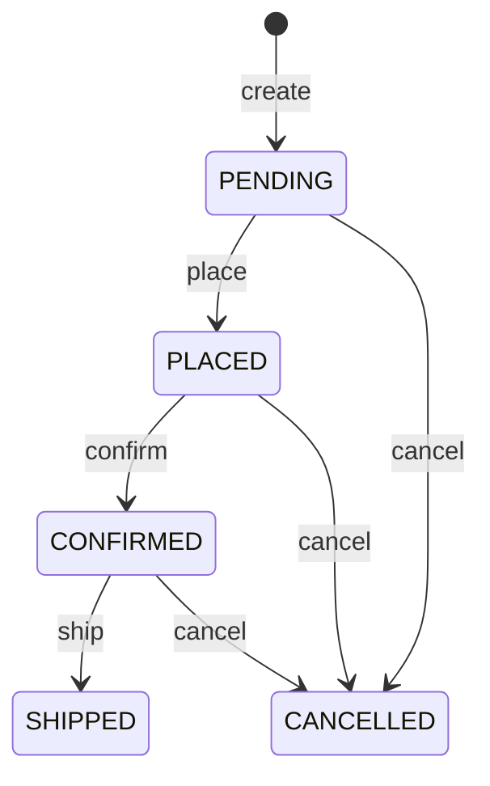

# Order placement, compensation, and lifecycle

Order owns its lifecycle, customer/email snapshot, item snapshots, and final total. Its HTTP command controller exposes POST `/api/v1/orders` (201) and PUT `/api/v1/orders/{id}/cancel` (204), translating requests into commands sent through `CommandBus`. Detail and list queries are separate; see [Order read model](../integrations/order-read-model.md).

## Placement sequence

`PlaceOrderCommandHandler` coordinates the following work without a handler-wide transaction:

1. Generate an order ID and reject duplicate book IDs across request lines.
2. Fetch available stock for every distinct book through `CatalogClient`.
3. Build domain item snapshots from the submitted title, unit price, currency, and quantity.
4. Calculate pricing, then create the pending Order with the stock snapshot.
5. Reserve each line synchronously through Catalog, recording successfully returned reservations.
6. Transition the Order to PLACED and save it through `OrderPersistence`.
7. Return a result from the original in-memory aggregate.

The handler checks Catalog stock, not Catalog title or price: those item values come from the request. Domain creation requires a nonblank email, nonempty items, consistent line currencies, and sufficient prefetched stock; `OrderItem` rejects nonpositive quantity. A stock check is a snapshot, and the later reserve call remains the point where Catalog can reject changed availability.

The price calculation first discounts each line with quantity at least five by 10%. If the resulting subtotal is at least 50,000 cents, it discounts that subtotal another 5%. Integer division rounds each percentage result down. These are numeric thresholds; the code does not convert currencies even though discount labels mention yuan. `OrderPricingService` has no I/O, but it is registered using a Spring `@Component` annotation despite its comment claiming zero Spring imports.

## Compensation and save boundaries

The reserve/place/save block catches exceptions and attempts to release every reservation whose reserve call returned successfully. A failed release is logged and the loop continues; the caller receives an `IllegalStateException` wrapping the placement failure. Prefetch, pricing, and aggregate-creation failures occur before this compensation block and before reservations are made.

This is best-effort compensation held in an in-memory list. It is not a durable saga or distributed transaction. If a reserve request applies remotely but its response fails, that book is not yet in the successful-reservation list. Repeating the POST also creates a new order ID; this handler has no incoming idempotency key. Catalog's aggregate-count model does not itself make reservation/release idempotent by order ID. See [Catalog inventory](catalog-inventory.md).

`OrderPersistenceAdapter.save()` owns a database transaction, reloads or creates the JPA entity, stores the complete items JSONB snapshot, attaches domain events, saves, then clears the aggregate's pending events. The before-commit outbox listener maps supported events in that transaction. After-commit listeners are a separate boundary: an exception propagated from post-commit work is not evidence that the already-committed order rolled back. Follow [Event delivery](../integrations/event-delivery.md) for relay and consumer guarantees.

## State transitions

Each transition above registers its domain event. Place, confirm, and ship require their specific preceding state; cancel rejects shipped and already-cancelled orders. Shipping and explicit confirmation exist in the domain model, but the current command controller exposes no shipping or manual-confirmation endpoint.

`OrderPlacedAutoConfirmListener` runs AFTER_COMMIT and dispatches a threshold check with 5,000 cents and currency `CNY`. The handler reloads the order and saves only when `confirmIfEligible` succeeds; absent orders are logged. Eligibility checks PLACED status and cents at or below the threshold, without comparing currency codes. This local event is not a Kafka subscription or payment confirmation.

The listener is synchronous and the auto-confirm handler/save path does not explicitly request `REQUIRES_NEW`. The source's after-commit callback and domain tests alone do not establish durable confirmation in a new transaction. The placement response is also built from the original aggregate, not the reloaded auto-confirmed instance, so it reports PLACED from that object. Verify persisted auto-confirm behavior separately when changing transaction wiring.

## Cancellation effects

`CancelOrderCommandHandler` loads the order, throws not-found if absent, calls `cancel(reason)`, and saves. It makes no Catalog HTTP call. Its event includes item snapshots; the outbox/Kafka path lets Catalog release inventory and Notification create a cancellation record asynchronously. A 204 cancellation response does not establish that either downstream effect has finished. [Notifications](notifications.md) describes the delivery records and demo adapters.

## Focused verification

Use [OrderTest](../../order/src/test/java/com/example/order/domain/model/OrderTest.java), [OrderAutoConfirmTest](../../order/src/test/java/com/example/order/domain/model/OrderAutoConfirmTest.java), and [OrderPricingServiceTest](../../order/src/test/java/com/example/order/domain/service/OrderPricingServiceTest.java) for domain behavior. [PlaceOrderCommandHandlerTest](../../order/src/test/java/com/example/order/application/command/order/PlaceOrderCommandHandlerTest.java) checks successful orchestration and insufficient stock with mocked ports. These tests do not establish crash-safe compensation or after-commit persistence. The [verification map](../testing/verification-map.md) explains component substitutions and the cancellation E2E test's stronger immediate-stock assumption.
