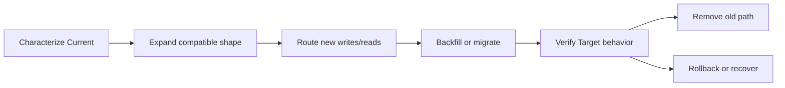

# Target 演进、表达与验证标准

本文件定义 Target 的 Brownfield 演进、Spec 表达和可验证性要求。它只消费 As-Is Baseline 与 Delta，不规定 Canonical As-Is 的扫描、修订或提升流程。

## 目录

- [Brownfield 模式](#brownfield-模式)
- [Current Evidence 与 Artifact Delta](#current-evidence-与-artifact-delta)
- [兼容与迁移](#兼容与迁移)
- [过渡产物](#过渡产物)
- [表达形式](#表达形式)
- [Mermaid 门禁](#mermaid-门禁)
- [验证层次](#验证层次)
- [追踪与结论](#追踪与结论)

## Brownfield 模式

Feature 设计以 resolved Service Ref Profile 上一个 `VERIFIED` SHA 为稳定业务服务 Current，并叠加 Pending Development/Feature Delta；涉及公共能力时同时读取 resolved Capability Current Ref 的 Capability As-Is。默认 Profile 仍为 `test/develop/feature`。以下模式描述 Target 相对 Current 的演进性质，不替代 Current Baseline mode：

选择：

- `GREENFIELD`：相关能力、数据和合同尚不存在；
- `BROWNFIELD_EXTEND`：在基本符合 Target 的边界内扩展；
- `BROWNFIELD_CONVERGE`：实现可运行但需要随功能收敛；
- `LEGACY_REPLACEMENT`：旧模型或机制需要分阶段替换。

先独立确认 Target，再设计 Current → Target。不要边看旧代码边扭曲目标模型；也不要忽视运行中的兼容事实。

## Current Evidence 与 Artifact Delta

Current Evidence 至少覆盖相关：

- Canonical Service As-Is Manifest、full SHA、environment 和 verification status；
- Pending Develop/Feature/Test Candidate Delta 与 merge-base；
- Capability Owner 的 resolved current-ref Baseline、有效模块版本、兼容和真实 consumers；
- 目标服务实际 resolved version、配置、扩展和 fit/gap；
- 入口和运行路径；
- 模块依赖；
- 数据 schema、索引和约束；
- API、event 和第三方合同；
- External Integration Dossier、readiness 与证据日期；
- 配置、部署和消费者；
- 事务、Durable Intent、Retry、Idempotency；
- 测试和可观测证据。

把“已确认”“推断”“未找到”分开。

Canonical Service As-Is 和 Canonical Capability As-Is 各自只有一个受治理写入流程。Spec 和 code review 可以输出相应 Baseline Gap 或 Delta Candidate，但不能把 Target 或未验证实现直接写成 Current。

每个 Current / Target 产物使用 Change Action：

- `KEEP`
- `MODIFY`
- `ADD`
- `MOVE`
- `RENAME`
- `REPLACE`
- `DELETE`

变更范围使用：

- `FEATURE_REQUIRED`
- `TARGET_CONSISTENCY_REQUIRED`
- `SHARED_CAPABILITY_REQUIRED`
- `FOLLOW_UP`

不要把无关历史债务塞入当前 feature，也不要让本次变更新增违反 Target 的实现。

## 兼容与迁移

默认采用 Expand → Migrate → Contract：



按需处理：

- API additive change、版本和弃用；
- event schema backward/forward compatibility；
- 数据列、索引、约束和回填；
- 双读、双写和切换；
- 滚动部署下的新旧版本组合；
- 公共能力升级对现有消费者的影响；
- 回滚、重放、对账和人工恢复。

数据库约束新增前先验证历史数据。Contract 前必须有可观测证据证明旧路径无消费者。

## 过渡产物

每个 `TRANSITION_ONLY` 产物记录：

- owner；
- 引入阶段；
- 服务的兼容目的；
- 可测删除条件；
- 最迟删除点；
- 删除验证；
- 回滚依赖。

没有删除条件的兼容 Adapter、双写、旧字段或旧事件版本不得批准。

## 表达形式

根据问题选择表达，不把所有内容机械表格化：

| 信息问题 | 首选表达 |
|---|---|
| 流程、分支、补偿和恢复 | `flowchart` |
| 谁在何时向谁发送什么 | `sequenceDiagram` |
| 业务对象或 Saga 生命周期 | `stateDiagram-v2` |
| Aggregate、Entity、VO 关系 | 精简 `classDiagram` |
| 表、键、约束和影子列 | `erDiagram` |
| 责任交接 | `swimlane-beta`；不兼容时用 `flowchart` + `subgraph` |
| 简单迁移时间顺序 | `timeline`；有分支时使用 `flowchart` |
| 字段、约束、映射和追踪 | 表格 |
| 依据、风险和取舍 | 短文或 ADR 引用 |

默认使用广泛支持的 `flowchart`、`sequenceDiagram`、`stateDiagram-v2`、`classDiagram` 和 `erDiagram`。C4、`architecture-beta`、`eventmodeling` 等仅在渲染器明确支持且确有需要时使用。

图和表不应成为两个重复事实源：

- 状态图表达转换；规则表补 guard、拒绝和 rule ID；
- 序列图表达顺序；合同表补字段、版本和交付；
- ER 图表达物理结构；派生产物表补来源和泄漏边界；
- 流程图表达步骤；责任表补事实所有者。

## Mermaid 门禁

每张图必须：

1. 能用一句话说明回答的问题；
2. 只包含当前层拥有或可见的概念；
3. 节点 ID 使用稳定 ASCII，标签可用业务语言；
4. 一个图只表达一个主要维度；
5. 节点使用短语，精确条件放边标签或图后表；
6. 关键转换引用 requirement/rule ID；
7. 不省略重要异常、超时、补偿和终态；
8. 不依赖颜色单独表达语义；
9. 在目标 Mermaid 渲染器通过语法检查。

Domain 图不出现持久化记录、具体消息产品、Mapper 或协议类型；Application 图只出现它看得见的 Domain 和 Port；Infrastructure 的存储图不得反向改写 Domain。

## 验证层次

按风险覆盖：

- **Domain**：纯行为、不变量、状态转换，无应用框架上下文和无 mock Domain object；
- **Application**：Handler 编排、Port 调用、错误传播；
- **Mapper**：方向、有损、未知值、精度、技术派生字段；
- **Adapter**：实际选定存储/协议下的约束、事务和映射；
- **Contract**：API、event schema 和第三方兼容；
- **Component**：完整服务边界和关键可靠性机制；
- **E2E**：少量跨服务业务结果；
- **Migration**：characterization、回填、跨版本、切换和回滚。

必须覆盖适用的并发、重复、乱序、超时、结果未知、重试、dead-letter、补偿、对账和人工恢复。存储唯一性、原子条件变更和锁必须使用实际选定的产品与有效版本验证，不能只依赖 mock。

## 追踪与结论

关键链路：

```text
Requirement / Acceptance Criterion
  → Domain meaning and decision
  → Application orchestration
  → Interface / Infrastructure / Integration guarantee
  → Verification evidence
  → Current-to-Target action
```

记录所有假设和未决问题。缺失信息若会改变 Aggregate、状态机、所有权、一致性或外部合同，则结论为 `BLOCKED`，不要用技术假设填补。

生成设计时使用：

- `PASS`
- `PASS WITH ASSUMPTIONS`
- `BLOCKED`

Spec 审查时使用：

- `APPROVE`
- `APPROVE WITH COMMENTS`
- `REQUEST CHANGES`
- `BLOCKED`

代码审查时使用：

- `PASS`
- `PASS WITH FINDINGS`
- `CHANGES REQUESTED`
- `BLOCKED`
