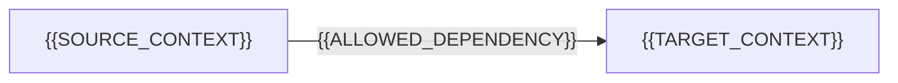

# {{TITLE}}

## Problem and Scope

{{PROBLEM_AND_SCOPE}}

## Boundaries and Ownership

| Fact / responsibility | Owner | Allowed readers/writers | Constraint |
|---|---|---|---|
| {{FACT}} | {{OWNER}} | {{ACCESS}} | {{CONSTRAINT}} |

## Architecture Constraints

- **MUST** {{MANDATORY_CONSTRAINT}}
- **SHOULD** {{RECOMMENDED_CONSTRAINT}}
- **MAY** {{OPTIONAL_VARIATION}}

## Variation Points and Exceptions

{{VARIATION_AND_EXCEPTION_PROCESS}}

## Conformance and Verification

{{CONFORMANCE}}

## Related Context

- Standards: {{STANDARDS}}
- Patterns: {{PATTERNS}}
- ADRs: {{ADRS}}
- Natural owner evidence: {{OWNER_LINKS}}
