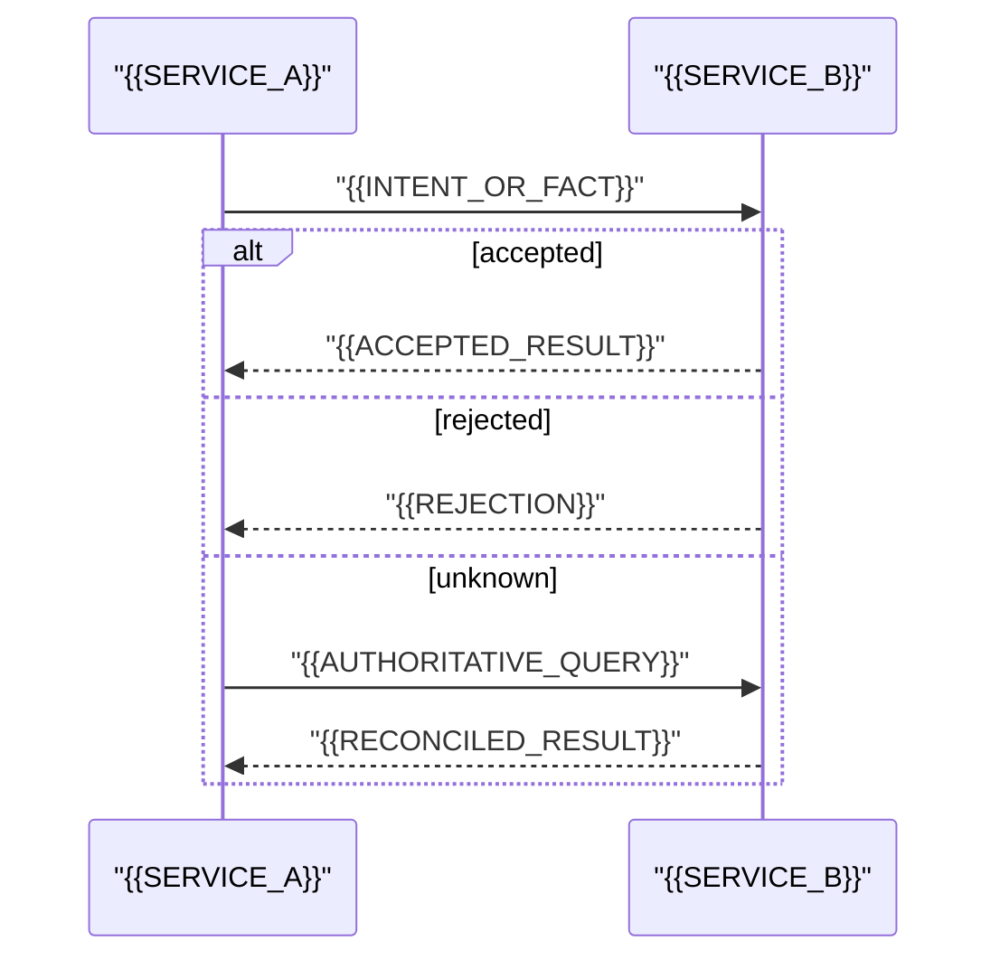

# {{FLOW_NAME}}

## Business Outcome and Participants

- Outcome: {{OUTCOME}}
- Trigger: {{TRIGGER}}
- Participants: {{PARTICIPANTS}}
- Process authority: {{PROCESS_AUTHORITY}}

## Authoritative Facts

| Fact / state | Authority | Local meaning | Advances which service | Evidence link |
|---|---|---|---|---|
| {{FACT}} | {{AUTHORITY}} | {{MEANING}} | {{SERVICE_RULE}} | {{EVIDENCE}} |

## Interaction

## Failure and Recovery

| Failure | Prevent / detect / recover | Owner | Contract / Pattern |
|---|---|---|---|
| {{FAILURE}} | {{TREATMENT}} | {{OWNER}} | {{REFERENCE}} |

## Related Context

{{RELATED_ARCHITECTURE_STANDARD_PATTERN_ADR_AND_OWNER_LINKS}}
