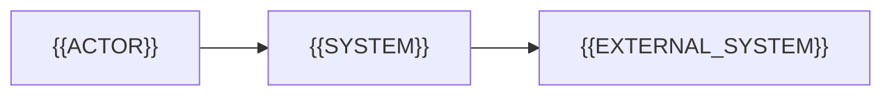

# System Context

## Scope and Actors

- System: {{SYSTEM}}
- Business capability: {{BUSINESS_CAPABILITY}}
- Actors: {{ACTORS}}
- Owner: {{OWNER}}

## Boundaries and Fact Ownership

| Boundary / fact | Owner | Responsibility | Detailed evidence |
|---|---|---|---|
| {{BOUNDARY_OR_FACT}} | {{OWNER}} | {{RESPONSIBILITY}} | {{OWNER_LINK}} |

## Related Context

- Service Catalog: {{SERVICE_CATALOG}}
- Architecture: {{ARCHITECTURE}}
- Cross-service flows: {{FLOWS}}
- Integrations: {{INTEGRATIONS}}
