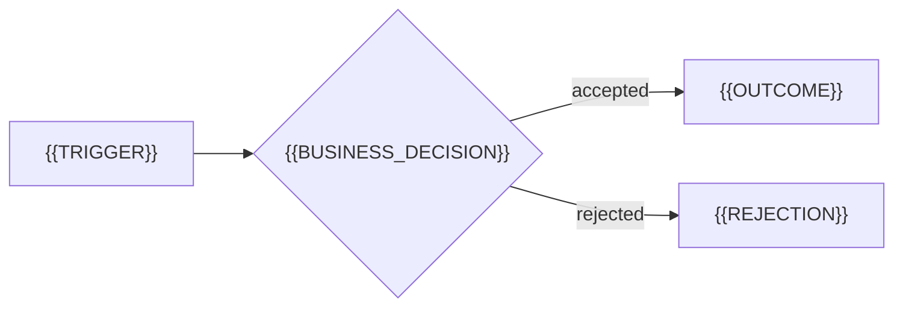
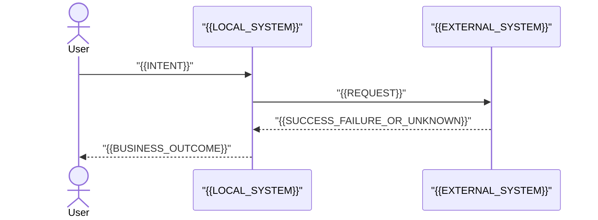

# Context — {{FEATURE}}

## Scope and Authority

- Goal: {{GOAL}}
- In scope: {{IN_SCOPE}}
- Out of scope: {{OUT_OF_SCOPE}}
- Canonical sources: {{SOURCES}}
- Evolution mode: `{{EVOLUTION_MODE}}`

## Central Architecture Context

| Repository / index | Immutable ref | Read at | Status |
|---|---|---|---|
| {{ARCHITECTURE_REPOSITORY}} / {{ARCHITECTURE_INDEX}} | `{{ARCHITECTURE_COMMIT_OR_VERSION}}` | {{ARCHITECTURE_READ_TIME}} | `{{CONTEXT_STATUS}}` |

| Document ID | Type | Authority | Scope / applicability | Status / exception | Applied constraint or use |
|---|---|---|---|---|---|
| {{ARCH_DOC_ID}} | `{{ARCH_DOC_TYPE}}` | `{{ARCH_DOC_AUTHORITY}}` | {{ARCH_DOC_APPLICABILITY}} | {{ARCH_DOC_STATUS_EXCEPTION}} | {{ARCH_DOC_USE}} |

### Architecture Context Gaps

| Gap | Spec impact | Treatment | Governance candidate |
|---|---|---|---|
| {{ARCH_CONTEXT_GAP}} | {{ARCH_CONTEXT_IMPACT}} | `BLOCKED / ASSUMPTION / NOT_APPLICABLE` | {{GOVERNANCE_CANDIDATE_ID}} |

## Service As-Is and Branch Inputs

| Ref Profile | Source | Verification ref | Development ref | Feature ref |
|---|---|---|---|---|
| {{SERVICE_REF_PROFILE_ID}} | `{{SERVICE_REF_PROFILE_SOURCE}}` | `{{VERIFICATION_REF}}` | `{{DEVELOPMENT_REF}}` | `{{FEATURE_REF}}` |

| Input | Immutable ref | Status | Relevant scope | Evidence timestamp |
|---|---|---|---|---|
| Canonical Service As-Is | `{{VERIFICATION_REF}}@{{VERIFIED_BASELINE_SHA}}` | `VERIFIED` | {{AS_IS_SCOPE}} | {{AS_IS_EVIDENCE_TIME}} |
| Pending Develop Delta | `{{BASELINE_SHA}}..{{DEVELOPMENT_SHA}}` | `PENDING` | {{DEVELOP_DELTA_SCOPE}} | {{DEVELOP_EVIDENCE_TIME}} |
| Feature Delta | `{{FEATURE_MERGE_BASE}}..{{FEATURE_SHA}}` | `PENDING / NOT_STARTED` | {{FEATURE_DELTA_SCOPE}} | {{FEATURE_EVIDENCE_TIME}} |

## Relevant Capability and Adoption Inputs

| Capability | Owner Baseline `{current-ref}@sha` / module version | Contract / guarantee / compatibility | Service resolved version / configuration / extension | Consumers | Fit / gap | Decision | Evidence |
|---|---|---|---|---|---|---|---|
| {{SHARED_CAPABILITY}} | {{CAPABILITY_BASELINE_VERSION}} | {{CAPABILITY_CONTRACT_GUARANTEE_COMPATIBILITY}} | {{SERVICE_CAPABILITY_ADOPTION}} | {{CAPABILITY_CONSUMERS}} | {{CAPABILITY_FIT_GAP}} | {{CAPABILITY_DECISION}} | {{CAPABILITY_EVIDENCE}} |

## Relevant External Integration Inputs

| External system | Contract / version | Process authority | Local use | Unknown / recovery | Readiness | Evidence |
|---|---|---|---|---|---|---|
| {{EXTERNAL_SYSTEM}} | {{EXTERNAL_CONTRACT_VERSION}} | {{PROCESS_AUTHORITY}} | {{LOCAL_USE}} | {{UNKNOWN_RECOVERY}} | `{{INTEGRATION_READINESS}}` | {{EXTERNAL_EVIDENCE}} |

## Technology Capability Profile

| Concern | Product / language / framework | Effective version / config | Evidence | Relevant capability | Limitation | Confidence |
|---|---|---|---|---|---|---|
| {{TECH_CONCERN}} | {{TECH_STACK}} | {{EFFECTIVE_VERSION}} | {{TECH_EVIDENCE}} | {{CAPABILITY}} | {{LIMITATION}} | `{{CONFIDENCE}}` |

## Requirements and Acceptance Criteria

| ID | Requirement / Rule | Acceptance evidence | Source |
|---|---|---|---|
| {{REQ_ID}} | {{REQUIREMENT}} | {{EVIDENCE}} | {{SOURCE}} |

## End-to-End Business Flow

## Cross-System Interaction

## Fact and State Ownership

| Fact / State | Authority | Local meaning | Advances local document? | Unknown/reconciliation |
|---|---|---|---|---|
| {{FACT}} | {{OWNER}} | {{MEANING}} | {{RULE}} | {{RECOVERY}} |

## Semantics, Decision and Guarantee

| Rule | Semantic owner | Decision location | Final guarantee | Effective point | Scope |
|---|---|---|---|---|---|
| {{RULE_ID}} | {{OWNER}} | {{DECISION}} | {{GUARANTEE}} | {{POINT}} | {{SCOPE}} |

## Design Forces and Failure Model

| Decision ID | Design forces | Authority / scope / point | Failure | Treatment | Rule reference |
|---|---|---|---|---|---|
| {{DECISION_ID}} | {{FORCES}} | {{AUTHORITY_SCOPE_POINT}} | {{FAILURE}} | {{PREVENT_DETECT_RECOVER_TOLERATE_EXCLUDE}} | {{ASIS_CASIS_DISC_DR_MECH_GEN_TECH_ID}} |

## Current Example vs Target

| Concern | Current evidence | Target decision | Evolution impact |
|---|---|---|---|
| {{CONCERN}} | {{CURRENT}} | {{TARGET}} | {{IMPACT}} |

## Capability Insights

{{CAPABILITY_INSIGHTS}}

## Architecture Governance Candidates

| ID | Type | Current authority | Gap | Proposed direction | Scope / compatibility | Urgency |
|---|---|---|---|---|---|---|
| {{GOVERNANCE_CANDIDATE_ID}} | `{{GOVERNANCE_CANDIDATE_TYPE}}` | {{CURRENT_AUTHORITY}} | {{GAP}} | {{PROPOSED_DIRECTION}} | {{GOVERNANCE_SCOPE}} | `{{URGENCY}}` |

## Assumptions and Open Questions

| ID | Assumption / Question | Why it matters | Status |
|---|---|---|---|
| {{QUESTION_ID}} | {{QUESTION}} | {{IMPACT}} | {{STATUS}} |
