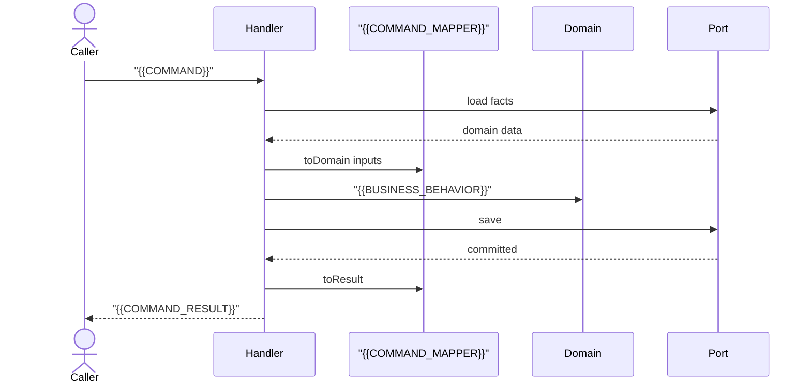

# Application — {{FEATURE}}

## Inherited Constraints

{{INHERITED_CONSTRAINTS}}

## Use Cases

| Type | Name | Input | Result | Domain behavior / Read Port |
|---|---|---|---|---|
| Command | {{COMMAND}} | {{INPUT}} | {{COMMAND_RESULT}} | {{BEHAVIOR}} |
| Query | {{QUERY}} | {{CRITERIA}} | {{QUERY_RESULT}} | {{READ_PORT}} |

## Handler Orchestration

## Mapper Contracts

| Mapper | Source | Target | Special / lossy rules | Error semantics |
|---|---|---|---|---|
| {{MAPPER}} | {{SOURCE}} | {{TARGET}} | {{RULES}} | {{ERROR}} |

## Outbound Ports

| Port | Core-language capability | Caller | Why Application-owned |
|---|---|---|---|
| {{PORT}} | {{CAPABILITY}} | {{CALLER}} | {{RATIONALE}} |

## Atomicity and I/O

| Use case | Atomicity intent | External I/O position | Post-commit mechanism |
|---|---|---|---|
| {{USE_CASE}} | {{ATOMICITY}} | {{IO_ORDER}} | {{MECHANISM}} |

## Process Manager / Saga

{{PROCESS_MANAGER_OR_NOT_APPLICABLE}}

## Error Semantics

| Error category | Stable meaning | Boundary handoff |
|---|---|---|
| {{CATEGORY}} | {{MEANING}} | {{HANDOFF}} |

## Capability Insights

{{CAPABILITY_INSIGHTS}}

## Leakage Check and Open Questions

{{LEAKAGE_AND_QUESTIONS}}
