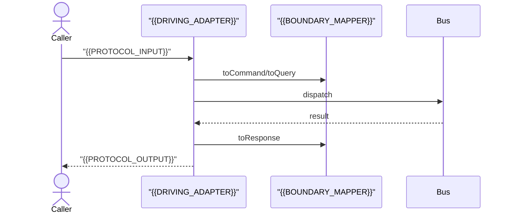

# Interfaces — {{FEATURE}}

## Inherited Constraints

{{INHERITED_CONSTRAINTS}}

## Protocol Contracts

| Operation / Channel | Protocol input | Command / Query | Result | Protocol output | Boundary Mapper |
|---|---|---|---|---|---|
| {{OPERATION_OR_CHANNEL}} | {{PROTOCOL_INPUT}} | {{INTENT}} | {{RESULT}} | {{PROTOCOL_OUTPUT}} | {{MAPPER}} |

## Protocol Validation and Errors

| Contract element | Syntax validation | Stable error | Business decision owner |
|---|---|---|---|
| {{ELEMENT}} | {{VALIDATION}} | {{ERROR}} | {{OWNER}} |

## Consumer / Webhook Contracts

| Source | Consumer/Handler | EventMapper | Internal intent | Idempotency handoff |
|---|---|---|---|---|
| {{SOURCE}} | {{CONSUMER}} | {{MAPPER}} | {{COMMAND}} | {{HANDOFF}} |

## Interaction

## Mapping / Handoff

{{MAPPING_HANDOFF}}

## Leakage Check and Open Questions

{{LEAKAGE_AND_QUESTIONS}}
