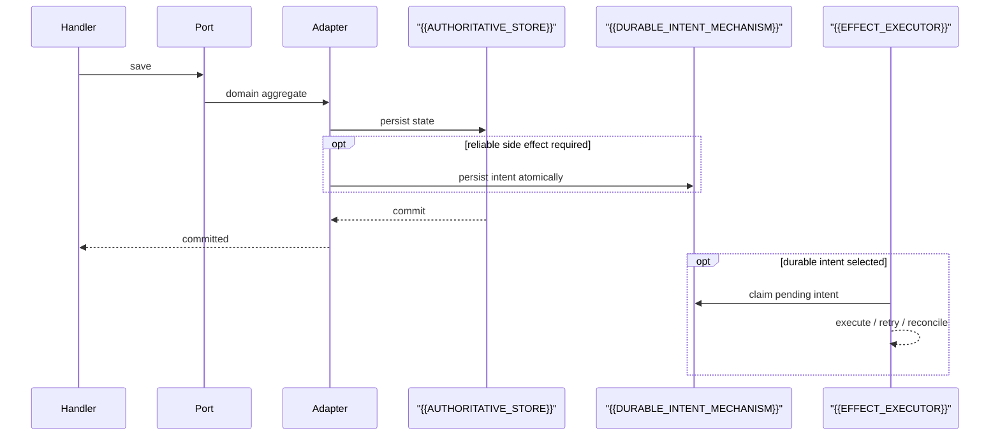

# Infrastructure — {{FEATURE}}

## Inherited Constraints

{{INHERITED_CONSTRAINTS}}

## Persistence Model

{{PERSISTENCE_MODEL_DIAGRAM}}

## Technology Decisions

| Decision | Architecture intent / mechanism | Effective stack and version | Capability evidence | Selected implementation | Integration limitation | Fallback / invalidation |
|---|---|---|---|---|---|---|
| {{TECH_DECISION_ID}} | {{INTENT_AND_MECHANISM}} | {{EFFECTIVE_STACK}} | {{CAPABILITY_EVIDENCE}} | {{IMPLEMENTATION}} | {{INTEGRATION_LIMITATION}} | {{FALLBACK_OR_INVALIDATION}} |

## Constraints and Derived Artifacts

| Artifact | Source rule | Derivation | Final guarantee | Effective point | Must not leak into |
|---|---|---|---|---|---|
| {{ARTIFACT}} | {{RULE_ID}} | {{DERIVATION}} | {{GUARANTEE}} | {{POINT}} | {{INNER_LAYER}} |

## Mechanism Decisions

| Required force | Mechanism | Owner | Scope / point | Failure covered | Residual risk | Evidence |
|---|---|---|---|---|---|---|
| {{FORCE}} | {{MECHANISM}} | {{OWNER}} | {{SCOPE_POINT}} | {{FAILURE}} | {{RESIDUAL}} | {{EVIDENCE}} |

## Adapter and Mapper Contracts

| Adapter / Mapper | Implements / Converts | Transaction / mapping responsibility |
|---|---|---|
| {{ADAPTER_OR_MAPPER}} | {{BOUNDARY}} | {{RESPONSIBILITY}} |

## Mapping Implementation Decision

- Strategy: `{{MAPPING_STRATEGY}}`
- Rationale / ADR: {{RATIONALE}}
- Unknown/lossy/derived rules: {{SPECIAL_RULES}}

## Save and Reliable Side Effects

## Transaction and External I/O

| Operation | Transaction boundary | External I/O | Failure translation |
|---|---|---|---|
| {{OPERATION}} | {{BOUNDARY}} | {{IO_POSITION}} | {{TRANSLATION}} |

## Reliability / Cache / Search / Client

{{TECHNICAL_MECHANISMS}}

## Migration and Rollback

{{MIGRATION_ROLLBACK}}

## Capability Insights

{{CAPABILITY_INSIGHTS}}

## Leakage Check and Open Questions

{{LEAKAGE_AND_QUESTIONS}}
