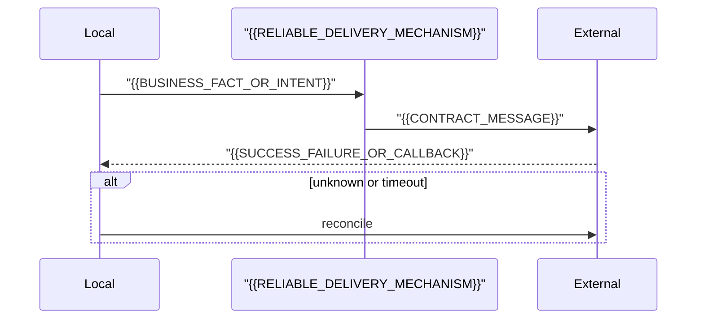

# Integration Contracts — {{FEATURE}}

## Evidence and Readiness

| External system | Evidence source | Contract / process version | Environment | Readiness | Gap / owner |
|---|---|---|---|---|---|
| {{EXTERNAL_SYSTEM}} | {{EVIDENCE_SOURCE}} | {{CONTRACT_PROCESS_VERSION}} | {{ENVIRONMENT}} | `{{READINESS}}` | {{GAP_OWNER}} |

## Contract Ownership

| Contract | Producer / Authority | Consumer | Version owner |
|---|---|---|---|
| {{CONTRACT}} | {{PRODUCER}} | {{CONSUMER}} | {{OWNER}} |

## External Process

{{EXTERNAL_PROCESS_DIAGRAM}}

| External fact / transition | Contract evidence | Authority | Local meaning / action | Late, duplicate or unknown handling |
|---|---|---|---|---|
| {{EXTERNAL_FACT}} | {{CONTRACT_EVIDENCE}} | {{FACT_AUTHORITY}} | {{LOCAL_MEANING_ACTION}} | {{ROBUSTNESS}} |

## Domain to Integration Mapping

| Domain Event | Integration Event / External request | Mapper | Semantic differences |
|---|---|---|---|
| {{DOMAIN_EVENT}} | {{INTEGRATION_EVENT}} | {{MAPPER}} | {{DIFFERENCES}} |

## Cross-System Sequence

## Schema and Compatibility

| Field / Concern | Semantics | Required | Compatibility / default |
|---|---|---|---|
| {{FIELD}} | {{MEANING}} | {{REQUIRED}} | {{COMPATIBILITY}} |

## Delivery and Recovery

| Concern | Decision |
|---|---|
| Delivery | {{DELIVERY}} |
| Idempotency key | {{IDEMPOTENCY}} |
| Ordering | {{ORDERING}} |
| Duplicate / replay | {{REPLAY}} |
| Timeout / unknown | {{UNKNOWN}} |
| Compensation | {{COMPENSATION}} |
| Reconciliation | {{RECONCILIATION}} |

## External State to Local Meaning

| External state/fact | Local meaning | Local transition | Unknown handling |
|---|---|---|---|
| {{EXTERNAL_STATE}} | {{LOCAL_MEANING}} | {{TRANSITION}} | {{UNKNOWN_HANDLING}} |

## Open Questions

{{OPEN_QUESTIONS}}
