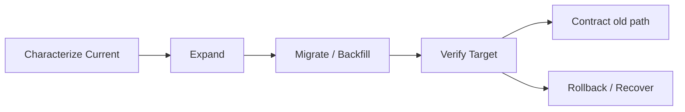

# Codebase Evolution — {{FEATURE}}

## Mode and Current Evidence

- Mode: `{{EVOLUTION_MODE}}`
- Service Ref Profile: `{{SERVICE_REF_PROFILE_ID}} / {{SERVICE_REF_PROFILE_SOURCE}}`
- Canonical Service As-Is: `{{VERIFICATION_REF}}@{{VERIFIED_BASELINE_SHA}}`
- Relevant Capability Baseline: `{{CAPABILITY_CURRENT_REF}}@{{CAPABILITY_CURRENT_SHA}} / {{CAPABILITY_MODULE_VERSION}}`
- Development ref: `{{DEVELOPMENT_REF}}@{{DEVELOPMENT_SHA}}`
- Feature merge-base/ref: `{{FEATURE_MERGE_BASE}}..{{FEATURE_SHA}}`
- Evidence scope: {{EVIDENCE_SCOPE}}

| Current artifact / behavior | Evidence | Target issue |
|---|---|---|
| {{CURRENT}} | {{EVIDENCE}} | {{ISSUE}} |

## Artifact Delta

| Current artifact | Target artifact | Conformance | Change action | Scope |
|---|---|---|---|---|
| {{CURRENT}} | {{TARGET}} | {{CONFORMANCE}} | {{ACTION}} | {{SCOPE}} |

## Pending Branch Delta

| Delta | From | To | Relevant fact / artifact | Interaction with Target |
|---|---|---|---|---|
| Development | `{{BASELINE_SHA}}` | `{{DEVELOPMENT_SHA}}` | {{DEVELOP_CHANGE}} | {{DEVELOP_TARGET_INTERACTION}} |
| Feature | `{{FEATURE_MERGE_BASE}}` | `{{FEATURE_SHA}}` | {{FEATURE_CHANGE}} | {{FEATURE_TARGET_INTERACTION}} |

## Evolution Flow

## Compatibility Matrix

| Surface | Old producer/client | New producer/client | Old consumer/server | New consumer/server |
|---|---|---|---|---|
| {{SURFACE}} | {{OLD_NEW}} | {{NEW_NEW}} | {{OLD_COMPAT}} | {{NEW_COMPAT}} |

## Data and Schema Evolution

{{DATA_SCHEMA_EVOLUTION}}

## Transitional Artifacts

| Artifact | Owner | Introduced phase | Removal condition | Latest removal | Rollback dependency |
|---|---|---|---|---|---|
| {{ARTIFACT}} | {{OWNER}} | {{PHASE}} | {{CONDITION}} | {{DEADLINE}} | {{ROLLBACK}} |

## Stages and Gates

| Stage | Entry condition | Change | Completion evidence | Rollback point |
|---|---|---|---|---|
| {{STAGE}} | {{ENTRY}} | {{CHANGE}} | {{EVIDENCE}} | {{ROLLBACK}} |

## Shared Capability Consumer Impact

{{SHARED_CAPABILITY_IMPACT}}

## Recovery and Open Questions

{{RECOVERY_AND_QUESTIONS}}
